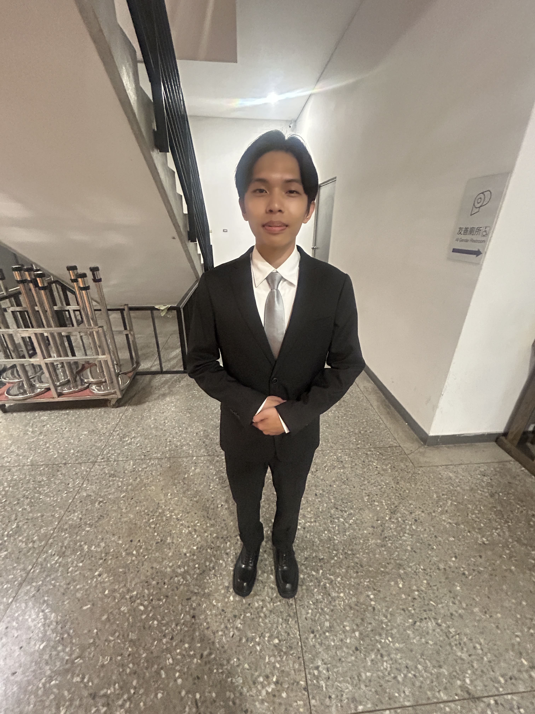
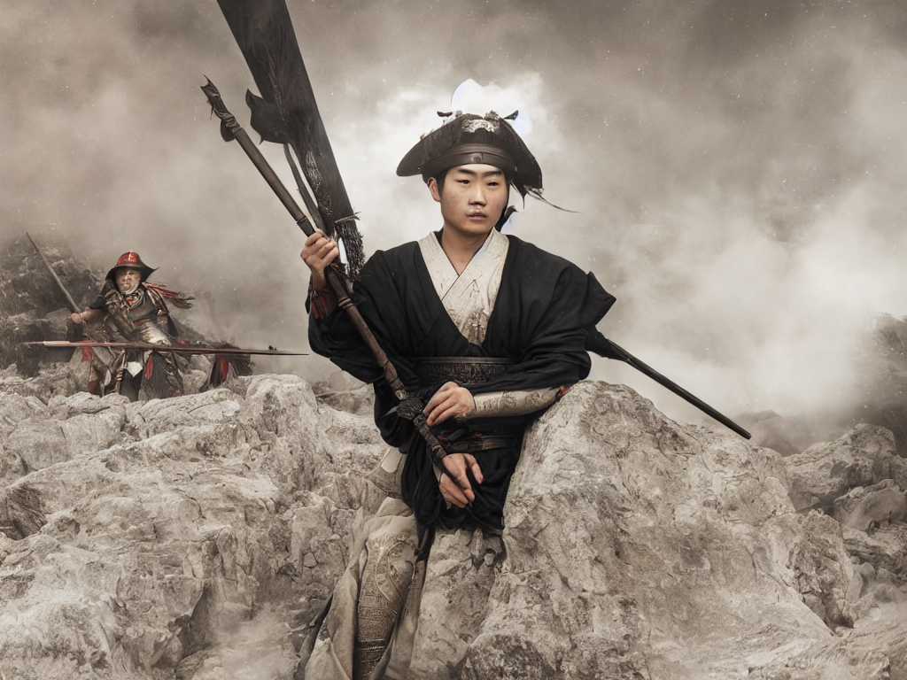
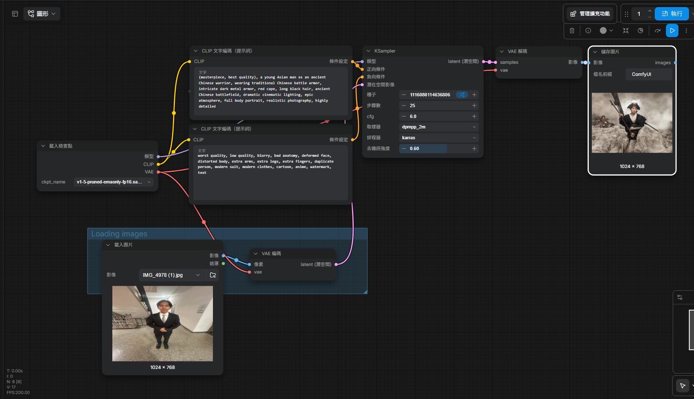

# ComfyUI 圖生圖作品

使用 ComfyUI 的 Image-to-Image（圖生圖）功能，將自己拍攝的人像照片轉換為古風戰士風格。

**[點此查看 GitHub Pages 完整作業網站](https://skyhsu320.github.io/comfyui-homework/)**

## 1. 原圖（自己拍攝的照片）



## 2. AI 生成圖



## 3. 完整工作流截圖



## 4. 提示詞

### 正向提示詞（Positive Prompt）

```text
(masterpiece, best quality), a young Asian man as an ancient Chinese warrior, wearing traditional Chinese battle armor, intricate dark metal armor, red cape, long black hair, ancient Chinese battlefield, dramatic cinematic lighting, epic atmosphere, full body portrait, realistic photography, highly detailed
```

### 反向提示詞（Negative Prompt）

```text
worst quality, low quality, blurry, bad anatomy, deformed face, distorted body, extra arms, extra legs, extra fingers, duplicate person, modern suit, modern clothes, cartoon, anime, watermark, text
```

## 5. 使用模型與參數

| 項目 | 設定 |
|---|---|
| AI 模型 | Stable Diffusion 1.5（`v1-5-pruned-emaonly-fp16.safetensors`） |
| Steps | 25 |
| CFG | 6 |
| Sampler | `dpmpp_2m` |
| Scheduler | `karras` |
| Denoise | 0.60 |

## 6. 個人心得

這次使用 ComfyUI 進行圖生圖練習，讓我理解節點之間的連接方式，以及模型、正反提示詞和 KSampler 參數的作用。一開始遇到找不到模型檔案的問題，後來學會在 ComfyUI Desktop 的共用模型資料夾中安裝模型。第一次生成時，因為原圖尺寸太大而耗費許多時間；改用較小的照片後，生成流程更順利。調整提示詞和 Denoise 數值之後，也能明顯看到圖片從正式服裝人像轉換為古風戰士的效果。這次作業讓我體會到 AI 生成圖片不只是輸入一句描述，而是要透過工作流和參數反覆測試。


